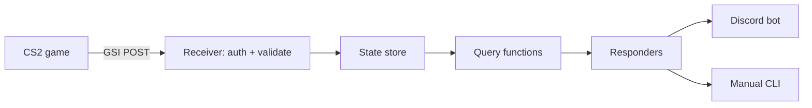

# Design: Anderdingus v0.1 (alpha)

## Goal

A Discord bot that answers CS2 players' questions about live game state ("who has the bomb?", "team economy?") from official Game State Integration (GSI) data. It only reads data; it never sends input to the game.

## Alpha 0.1 definition (what "done" looks like)

One player runs CS2 with a GSI config. In a Discord server, they type `/bomb`, `/economy` or `/round` and the bot replies with the right answer from live data. Plain code, no model, everything on the owner's PC. A short demo recording is the exit test.

Not in alpha 0.1: multiple players, voice, natural language, any model, callouts, minimap.

## Architecture

- **Event source** (receiver): the only part that knows about GSI. A vision source can be added beside it later.
- **State store**: latest payload plus short history, with timestamps. Games differ; the store holds normalized state.
- **Queries**: pure functions over state. Easy to test with fixtures. Reused by every responder.
- **Responders**: Discord and the manual CLI call the same queries. A model, if any, sits here later and only rephrases or routes.
- **Game adapter**: the boundary between a game's raw data and normalized state, so other games can plug in.

## Testing

Fixtures replay through the real receiver, so the game is not needed for tests. The game is needed twice: to record real payloads and verify the schema, and for the alpha demo.

## Sprints

1. **Pipeline proven.** Merge the first slice (receiver, store, queries, manual controls). Record real payloads from a live match, replace the hand-written fixtures, fix the schema. Exit: manual `replay` and `ask` work against a real recording.
2. **Alpha 0.1.** Discord bot with the three slash commands for one player, running locally. Needs a Discord bot token. Exit: demo recording.
3. **Team state.** A companion app sends each friend's GSI to the bot over the network with per-player identity; merge into team state (team economy, bomb across the team). Needs a way for friends' PCs to reach the bot (open question below).
4. **Later, in order:** model decision and natural-language queries; round callouts; voice; minimap vision spike.

## Open questions

- **Model:** rules only, local model, or paid API. Parked until we know the GPU (see backlog item 5).
- **Networking for sprint 3:** the bot runs on the owner's PC, so friends need a safe route to it (a private network tool or a tunnel). Decide before sprint 3.
- **GSI limits:** each player only reports their own state, so team features need every friend to run the companion.

## Integrity

Only data a player could legitimately see or that teammates share. No automated input. Live-assist use in public or tournament play needs a per-game, per-platform rules check first.
